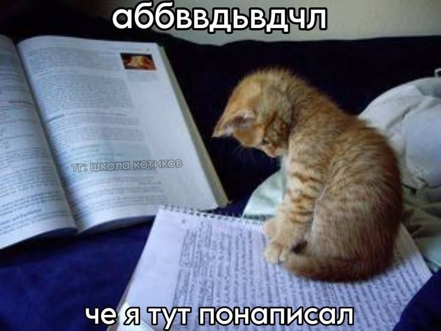
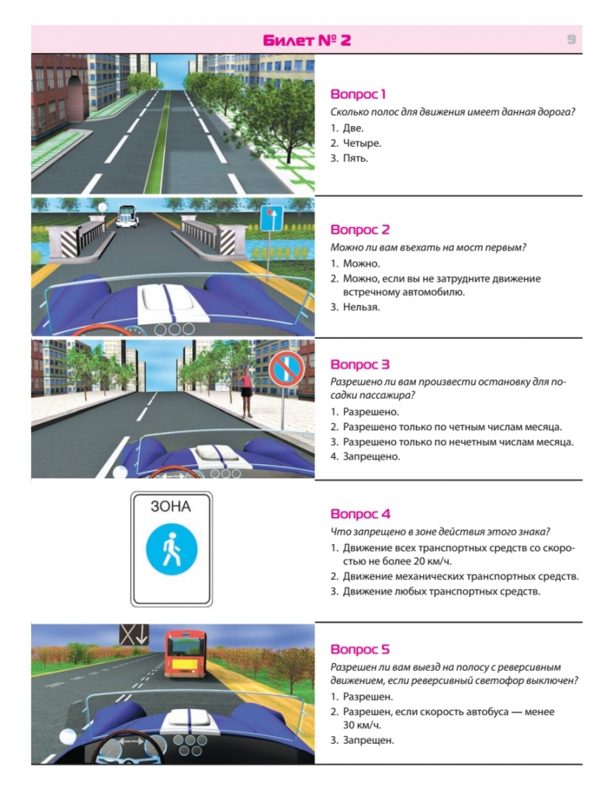

# Бриф

## Назначение продукта

Продукт предназначен для студентов, которые готовятся к зачёту или экзамену по собственным учебным материалам. Он преобразует содержание конспекта в карточки для повторения, поддерживает проверку свободных ответов и формирует расписание интервального повторения.

## Целевой сценарий использования

В начале подготовки студент загружает конспект в формате текста. Система выделяет понятия, утверждения, связи и формулы, представляющие учебную ценность, и формирует черновики карточек. Каждая карточка содержит вопрос или задание, эталонный ответ, критерии проверки и привязку к фрагменту источника.

В ходе подготовки студент регулярно обращается к очереди повторения и отвечает на задания своими словами. Система сопоставляет свободный ответ с критериями карточки и фрагментом-основанием, указывает корректно воспроизведённые и недостающие смысловые элементы. Студент может свериться с эталонным ответом и источником..

После повторения программный планировщик рассчитывает следующую дату показа карточки с учётом истории и результатов ответов.

При успешной работе продукта студент продолжает использовать колоду на протяжении подготовки и способен воспроизвести изученное при отложенной проверке перед зачётом или экзаменом.

## Индивидуальное понимание проекта

### Участник 1 — Product / VO

Описание: 

Я понял проект так: это система, которая помогает студенту готовиться к зачёту или экзамену по обычному текстовому конспекту. Студент загружает конспект, а система сама вытаскивает из него самое важное — понятия, утверждения, связи и формулы — и делает из этого черновики карточек. В каждой карточке есть вопрос или задание, эталонный ответ, критерии проверки и ссылка на кусок конспекта, откуда это взялось.

Если всё работает хорошо, студент пользуется такой колодой всю подготовку и перед экзаменом может нормально воспроизвести изученное. 

Система обладает пользой, и ее плюсы несложно выделять.

### Участник 2 — AI Engineer

Описание: 

Я поняла проект, как продукт для повторения уже изученного материала. Также этот проект позволит приобрести дополнительный опыт с моделью и планировщиками. Именно поэтому мне достаточно интересно им заниматься.

Я представляю основной сценарий так:

1. Студент загружает материал.
2. Модель анализирует материал: выделяет ключевую информацию.
3. Система создаёт карточки: различных типов.
4. Студент отвечает своими словами. Система оценивает смысл ответа.
5. Дополнительно встроен планировщик, который возвращает темы на повтор.

### Участник 3 — Delivery

Описание того, как я представлю проект:

Разрабатываемый продукт должен помочь студентам, чьё обучение завязано на изучение большого количества текстовых лекций. Конкретное направление на мой взгляд выделить сложно, так какпредметы с таким форматом лекций встречаются у всех учащихся. Как например философия на техничесикх специальностях.
Автоматическая генерация карточек в разы сократит время, потребное на подготовку. Для меня этот этап был одним из наиболее сложных при работе с такими предметами.
Само же применение систем, которые чередуют карточки в зависимости от частоты правильных ответов - доказало свою высокую эффективность. Самый удачный на мой взгляд пример - приложения для изучения ПДД.
В итоге наша команда создаёт инструмент, который позволит применять очень эффективную методику усвоения информации для запоминания самых разнообразых материалов. Успех разработки позволит повысить общее качество получаемых знаний для очень широкого круга пользователей.

### Участник 4 — Quality & Safety

Описание: 

Я вижу наш проект как умного помощника для студентов, который упрощает подготовку к зачётам и экзаменам. Вместо того чтобы вручную превращать конспект в десятки вопросов, студент передаёт учебные материалы и список вопросов к зачёту, а система помогает собрать карточки для повторения.

Идея не в том, чтобы просто выдать много красивого текста. Главная цель — помочь человеку разобраться в материале и проверить, что он действительно его помнит.

Я представляю основной сценарий так:

1. Студент загружает конспект и вопросы к зачёту.
2. ИИ анализирует материал: выделяет определения, ключевые идеи и информацию, связанную с вопросами.
3. Система создаёт карточки: вопрос и ответ, который можно проверить по исходному конспекту.
4. Студент отвечает своими словами. Система оценивает не только совпадение слов, но и смысл ответа.
5. Сложные темы возвращаются на повторение чаще. Так студент тратит больше времени на то, что ещё не усвоил.

