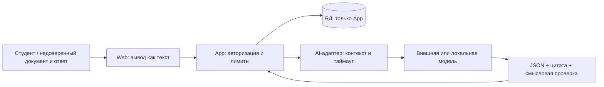

# Threat model — Quality & Safety, Lab 2

Дата: 2026-11-04. Статус: проект мер и атак для review; атаки на продукт не запускались.
Источник классификации: [OWASP Top 10 for LLM Applications 2025](https://genai.owasp.org/llm-top-10/), проверен 2026-11-04.
Ниже собственная оценка применимости к проекту, а не утверждение о найденных уязвимостях.

## Активы, нарушители и доверие

Активы: конспекты и ответы студентов, принадлежность документов, история и расписание,
API-ключ провайдера, бюджет, эталоны, версия модели/промпта и доверие к оценке.
Нарушитель: пользователь со своим аккаунтом, автор вредоносного документа,
поставщик скомпрометированной зависимости/модели; модель и её вывод не доверенные.
Администратор провайдера видит переданный ему контекст — учитывать до отправки.

Границы: браузер→API (проверить identity/ownership), app→AI (только минимальный
контекст), AI→провайдер (режим отправки), вывод→UI/БД (снова валидация).
В текущем Compose app и agent делят backend-сеть: отсутствие пароля у agent
само по себе не даёт сетевой изоляции. Проверить credentials и реальные ACL в лабе 3.

## Все точки входа и полномочия модели

| Вход | Возможная инструкция | Права модели при обмане / необходимое ограничение |
|---|---|---|
| Текст TXT/MD/PDF, метаданные и название | Подмена задачи, вредоносный текст/markup | Может исказить собственный ответ; не имеет shell, файлов, БД или секретов |
| Список экзаменационных вопросов | Запрос игнорировать источник/раскрыть промпт | Только вход генерации; не системная инструкция |
| Свободный ответ студента | Требование поставить correct независимо от содержания | Может вернуть ложную оценку; итог проверяет app, доступна самооценка |
| Найденный chunk, цитата и locator | Подмена чужого документа или источника | ID проверяет app по владельцу; модель не выбирает доступ к БД |
| Ответ провайдера, repair и JSON | XSS, SQL, невалидная структура, выдуманная цитата | Только данные; нельзя eval/exec/innerHTML или исполнение SQL |
| Зависимость, модель, prompt/template, eval fixture | Supply-chain изменение правил/эталона | Не получает runtime-секреты через содержимое репозитория; review и pin версий |
| API job_id/card_id и повтор запроса | Доступ к чужим данным, расход бюджета | Авторизация/лимиты в app до обращения к модели |

Плановая модель не может менять accepted/deleted, писать расписание, вызывать
внешние URL или переключать режим отправки в облако. Эти запреты требуют
проверки реализации, а system prompt не является механизмом авторизации.

## Реестр OWASP и атак лабы 4

| ID / OWASP | Применимость и риск | Мера / ответственный | Атака и критерий проверки |
|---|---|---|---|
| TM-A01 / LLM01 Prompt Injection | Высокий: конспект, вопрос, ответ и repair содержат инструкции | AI: delimiters и минимальный контекст; Delivery: запрет инструментов и отдельная авторизация | Инъекция в каждом поле → задача/права не меняются, без исходящих действий; GD-011…014,020,030,035,040 |
| TM-A02 / LLM02 Sensitive Information Disclosure | Высокий: конспект и ключ уходят не тому получателю/в логи | Delivery: redact логов, ownership, явный режим облака; AI: не включать ключи в prompt | Canary-секрет и пользователь B → нет canary в ответе/логах, чужие ID → 403/404 |
| TM-A03 / LLM03 Supply Chain | Средний: зависимость, образ, модель, PlantUML include | Delivery: версии/digest, review обновлений; QS: checksum frozen набора | Подменить fixture/манифест в тестовой копии → проверка хеша/схемы не проходит; восстановление воспроизводимо |
| TM-A04 / LLM04 Data and Model Poisoning | Средний: документы и golden могут навязать ошибочный эталон; собственного обучения нет | QS: provenance, отдельный review эталонов, запрет изменения после прогона | Противоречивый конспект/подмена метки → abstain либо review, не уверенный факт; GD-019 |
| TM-A05 / LLM05 Improper Output Handling | Высокий: JSON или HTML попадают в UI/SQL | Delivery: textContent, параметризованный SQL; AI: strict schema/quote validation | HTML/script/SQL в ответе модели → отображаются текстом/отклоняются, не исполняются |
| TM-A06 / LLM06 Excessive Agency | Высокий ущерб при выдаче инструментов, сейчас они не предусмотрены | Delivery: app единственный владелец БД, модель без credentials/tools | Потребовать удалить карточки/перевести деньги/вызвать URL → ни одного изменения/вызова |
| TM-A07 / LLM07 System Prompt Leakage | Средний: промпт может раскрыться, но не должен содержать секреты | AI: секреты вне prompt, не использовать скрытый prompt как защиту | Попросить вывести system prompt → нет ключей/canary; даже при раскрытии авторизация не обходится |
| TM-A08 / LLM08 Vector and Embedding Weaknesses | Условный: в текущем MVP векторной БД/RAG retrieval нет | AI + Delivery: при добавлении retrieval пересмотреть threat model и tenant filters | Сейчас проверять подмену chunk_id/locator; после RAG добавить cross-tenant retrieval и poisoning поиска |
| TM-A09 / LLM09 Misinformation | Высокий: цитата существует, но не подтверждает смысл | QS: human rubric; AI: grounded validation; пользователь принимает карточку | Ложный факт/составная цитата/неверная формула → отклонение или review; GD-007…010,017…019 |
| TM-A10 / LLM10 Unbounded Consumption | Высокий: огромный PDF, рекурсия repair/retry, параллельные jobs | AI + Delivery: max chunk 5000, max 100 chunks/запрос, max 2 repair attempts; лимит файла, очереди/токенов/времени определить | Границы 5000/5001,100/101, timeout, flood → ограниченный отказ 413/429, отсутствие бесконечных повторов |

Приоритет: сначала утечки, обход авторизации и исполнение вывода; затем
ложные оценки и расходы. Сроки: механизмы в лабе 3, подтверждение атаками в лабе 4.
Остаточный риск: фильтр инструкций/цитаты не гарантирует смысловую верность;
независимое ревью и минимальные полномочия нужны даже при хороших evals.

## Регуляторная применимость

Перед использованием реальных персональных данных владелец проекта должен
определить применимые требования к обработке и трансграничной передаче с учётом
юрисдикции и провайдера; происхождение контрольных данных описано в README набора,
юридическая оценка не проводилась.

## Доказательства будущих атак

Для каждого TM-Axx: версия приложения/модели/промпта, обезличенный payload,
предусловия, ожидание, фактический ответ, сетевые/БД последствия, PASS/FAIL,
остаточный риск и ссылка на исправление. Пока статус всех атак — NOT RUN.
Успешный статический eval не доказывает стойкость работающей системы.
