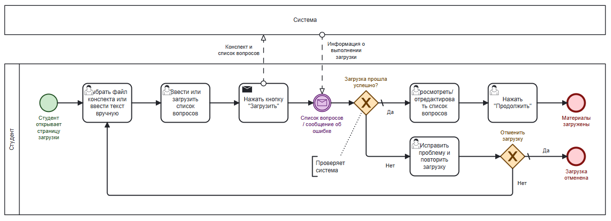

# UC-01. Загрузка конспекта и списка вопросов по зачёту

**Актор:** Студент, готовящийся к зачёту

**Цель:** передать системе свой конспект и список вопросов, чтобы получить готовые карточки для повторения

**Предусловия:** студент открыл приложение и находится на стартовом экране

## Графический сценарий

## Описание
Студент начинает работу с того, что загружает свой учебный материал и список вопросов, по которым будет готовиться. Это отправная точка: без этих данных система не может создать карточки. Студент может загрузить конспект файлом (TXT, MD или PDF) и либо ввести вопросы вручную, либо тоже загрузить их файлом.

## Начальное состояние
- Студент видит стартовый экран с кнопкой «Загрузить материалы»
- У студента под рукой есть файл конспекта и список вопросов (в голове, в файле или в тексте)

## Триггер
Студент нажимает кнопку «Загрузить материалы».

## Успешный сценарий (happy path)
1. Студент нажимает «Выбрать файл конспекта» и указывает свой файл (TXT, MD или PDF).
2. Студент вводит список вопросов в текстовое поле (по одному вопросу на строку) ИЛИ нажимает «Загрузить вопросы файлом» и выбирает второй файл.
3. Студент нажимает «Загрузить».
4. Студент видит, что система приняла файлы: появляется список распознанных вопросов и подтверждение, что конспект загружен.
5. Студент при необходимости редактирует список вопросов прямо на экране (убирает лишнее, добавляет пропущенное).
6. Студент нажимает «Продолжить» и переходит к формированию карточек (UC-02).

## Альтернативные сценарии
- **2а. Студент вводит вопросы вручную.** Студент просто печатает вопросы в текстовое поле — система принимает их по мере ввода.
- **2б. Студент загружает вопросы файлом.** Студент прикрепляет второй файл со списком вопросов — система сама извлекает из него вопросы.
- **5а. Студент редактирует список вопросов.** Студент замечает опечатку или лишний вопрос, исправляет его прямо в списке перед продолжением.

## Негативные сценарии (error handling)
- **1а. Неподдерживаемый формат файла.** Студент выбрал файл в формате, который система не принимает (например, DOCX или изображение). Система сообщает об этом и предлагает выбрать TXT, MD или PDF. Студент выбирает другой файл.
- **1б. Повреждённый или нечитаемый файл.** Студент загрузил файл, из которого не удаётся извлечь текст (например, скан без распознавания). Система сообщает, что не может прочитать содержимое, и предлагает загрузить другой файл или преобразовать его в текстовый формат.
- **1в. Пустой файл.** Студент загрузил файл, в котором нет текста. Система сообщает об этом и просит проверить файл.
- **2в. Список вопросов пустой.** Студент не ввёл ни одного вопроса или загрузил пустой файл. Система сообщает, что нужен хотя бы один вопрос, и студент добавляет вопросы.
- **3а. Превышен размер файла.** Студент загрузил файл больше допустимого лимита. Система сообщает об ограничении и предлагает уменьшить файл.
- **3б. Ошибка сети.** Во время загрузки пропало соединение. Система сообщает о проблеме, и студент повторяет попытку.

## Конечное состояние
- При успешном сценарии — студент видит свой список вопросов и подтверждение загрузки конспекта, готов перейти к следующему шагу.
- При любом негативном сценарии — студент остаётся на экране загрузки, система ждёт исправления проблемы.

## Результат
Студент передал системе конспект и список вопросов. Система готова создать карточки.

## Как поймём, что работает
- Студент может загрузить конспект в формате TXT, MD или PDF.
- Студент может ввести вопросы вручную или загрузить их файлом.
- После загрузки студент видит список вопросов и может его отредактировать.
- Неподдерживаемые форматы, пустые файлы и ошибки сети обрабатываются понятными сообщениями.
- Время загрузки файла до 10 МБ — не более 5 секунд.
- Студент понимает, что делать на каждом шаге, без необходимости читать инструкции.
