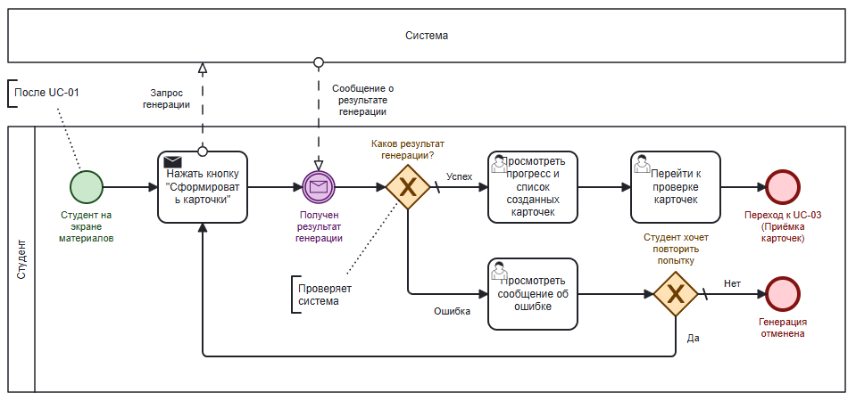

# UC-02. Формирование набора карточек по вопросам

**Актор:** Студент, готовящийся к зачёту

**Цель:** получить готовые карточки по каждому вопросу из своего списка, составленные на основе загруженного конспекта

**Предусловия:** студент загрузил конспект и список вопросов (UC-01), видит экран с подтверждением загрузки

## Графический сценарий

## Описание
После загрузки материалов студент запускает процесс создания карточек. Система анализирует конспект и для каждого вопроса из списка формирует краткую карточку с ответом. Процесс занимает некоторое время (особенно для больших конспектов), поэтому студент видит прогресс и может следить за ним. По итогам студент получает набор карточек, готовых к проверке.

## Начальное состояние
- Студент видит экран с загруженным конспектом и списком вопросов
- Кнопка «Сформировать карточки» доступна

## Триггер
Студент нажимает «Сформировать карточки».

## Успешный сценарий (happy path)
1. Студент нажимает «Сформировать карточки».
2. Студент видит экран прогресса: список своих вопросов и индикаторы состояния рядом с каждым (ожидание / в работе / готово).
3. Студент наблюдает, как вопросы постепенно переходят в статус «готово».
4. Студент видит итог: сколько вопросов обработано, сколько карточек создано, сколько потребовало внимания.
5. Студент нажимает «Перейти к проверке карточек» и переходит к их приёмке (UC-03).

## Альтернативные сценарии
- **2а. Студент прерывает процесс.** Студент нажимает «Отменить» во время генерации. Система останавливает процесс и сохраняет уже созданные карточки. Студент может позже запустить генерацию заново для оставшихся вопросов.
- **3а. Часть вопросов не удаётся обработать.** Студент видит, что некоторые вопросы помечены как «ошибка». Система предлагает повторить генерацию только для этих вопросов. Студент нажимает «Повторить» и наблюдает за повторной попыткой.

## Негативные сценарии (error handling)
- **1а. Ошибка сети при запуске.** Студент нажал кнопку, но соединение прервалось. Система сообщает о проблеме и предлагает попробовать снова.
- **2б. Длительное ожидание.** Студент ждёт завершения генерации большого конспекта. Система показывает понятный индикатор прогресса и оценку оставшегося времени, чтобы студент понимал, что процесс идёт.
- **3б. Все вопросы завершились с ошибкой.** Студент видит сообщение, что не удалось создать ни одной карточки. Система предлагает проверить конспект или попробовать позже.

## Конечное состояние
- При успешном сценарии — студент видит набор созданных карточек и готов перейти к их проверке.
- При альтернативном сценарии 3а — студент видит частично готовый набор и может повторить генерацию для проблемных вопросов.
- При негативном сценарии — студент остаётся на экране прогресса или получает сообщение об ошибке.

## Результат
Студент получил набор карточек по своим вопросам. Карточки готовы к проверке и редактированию.

## Как поймём, что работает
- Студент нажимает одну кнопку и видит понятный прогресс.
- Для каждого вопроса из списка создана карточка или показана понятная причина, почему не удалось.
- Время обработки конспекта из 8 страниц — не более 10 минут, при этом интерфейс остаётся отзывчивым.
- Студент может прервать процесс и вернуться к нему позже.
- Студент видит итоговую сводку и понимает, сколько карточек готово.
