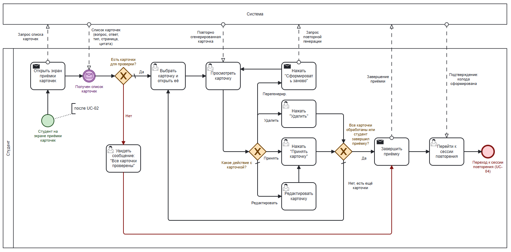

# UC-03. Приёмка и редактирование карточек

**Актор:** Студент, готовящийся к зачёту.

**Цель:** проверить созданные карточки, оставить только качественные и отредактировать неточные - чтобы в колоду для повторения попали только проверенные материалы.

**Предусловия:** система сформировала карточки по вопросам студента (UC-02), студент видит список готовых карточек.

## Графический сценарий

## Описание
Система создала карточки автоматически, но студент лучше знает свой материал и понимает, что важно. Поэтому студент просматривает каждую карточку и решает: принять её, поправить, удалить или попросить систему переделать. Только одобренные студентом карточки попадают в колоду для повторения.

## Начальное состояние
- Студент видит список вопросов и количество карточек по каждому
- Карточки ещё не проверены студентом

**Триггер** 
Студент открывает страницу приёмки карточек после завершения генерации.

## Успешный сценарий (happy path)
1. Студент видит список вопросов и нажимает на один из них, чтобы открыть карточку.
2. Студент читает карточку: вопрос, ответ, тип карточки, номер страницы в конспекте и точную цитату, на которой основан ответ.
3. Студент решает, что карточка корректна, и нажимает «Принять».
4. Студент переходит к следующей карточке и повторяет проверку.
5. Студент проверяет все карточки и нажимает «Завершить приёмку».
6. Студент видит подтверждение, что колода сформирована, и может перейти к повторению (UC-04).

## Альтернативные сценарии
- **3а. Студент редактирует карточку.** Студент замечает неточность в вопросе или ответе, нажимает «Редактировать», вносит правки и сохраняет. Карточка остаётся на проверке до явного принятия.
- **3б. Студент удаляет карточку.** Студент видит, что карточка дублирует другую, содержит неважную информацию или некорректна. Он нажимает «Удалить», и карточка исчезает из списка.
- **3в. Студент просит переделать карточку.** Студент недоволен формулировкой или содержанием. Он нажимает «Сформировать заново», и система создаёт новую версию карточки. Студент проверяет её.

## Негативные сценарии (error handling)
- **3а/3б. Ошибка сохранения.** Студент внёс правки или удалил карточку, но соединение прервалось. Система сообщает о проблеме, и студент повторяет действие.
- **3в. Ошибка при перегенерации.** Студент попросил переделать карточку, но система не может это сделать сейчас. Система сообщает об этом и предлагает повторить позже.

## Конечное состояние
- При успешном сценарии - студент сформировал колоду из принятых карточек и готов к повторению.
- При альтернативных сценариях - студент отредактировал, удалил или перегенерировал часть карточек, колода сформирована из одобренных.
- При негативных сценариях - состояние карточек не изменилось, студент может повторить действие.

## Результат
Студент проверил все карточки и сформировал колоду для повторения. В колоде только те карточки, которые студент одобрил.

## Как поймём, что работает
- Студент видит для каждой карточки вопрос, ответ, тип, номер страницы и цитату из конспекта.
- Кнопки «Принять», «Удалить», «Сформировать заново» и возможность редактирования работают предсказуемо.
- Только принятые карточки попадают в колоду для повторения.
- Время перехода между карточками — до 2 секунд.
- Студент понимает, что происходит на каждом шаге, и чувствует контроль над процессом.
