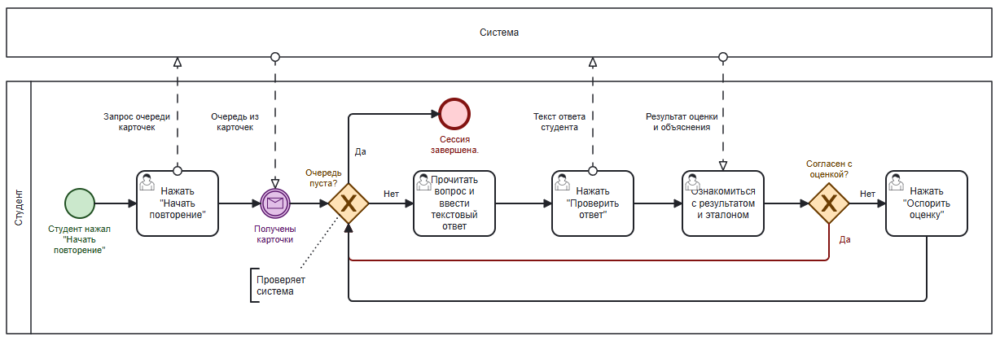

# UC-04. Сессия повторения (кривая забывания)

**Актёр:** Студент, готовящийся к зачёту

**Цель:** пройти тренировку по одобренным карточкам, чтобы закрепить знания и закрыть набор с минимальным числом циклов

**Предусловия:** студент проверил и одобрил хотя бы часть карточек (UC-03), сформировав активную колоду

## Графический сценарий

## Начальное состояние
- У студента есть одобренные карточки, готовые к повторению.
- Студент находится на главном экране или в разделе набора материалов.

**Триггер** 
Студент нажимает кнопку «Начать повторение».

## Успешный сценарий (happy path)
1. Студент нажимает «Начать повторение».
2. Студент видит первую карточку из очереди: вопрос, тип карточки и номер страницы в конспекте (цитата скрыта, чтобы не подсказывать).
3. Студент вводит свой ответ текстом в специальное поле.
4. Студент нажимает «Проверить ответ».
5. Студент видит результат проверки: оценку («Верно», «Частично верно» или «Неверно»), краткое объяснение и эталонный ответ для сравнения.
6. Студент соглашается с оценкой и нажимает «Далее».
7. Система показывает следующую карточку. Шаги 2–6 повторяются, пока не закончатся карточки на сегодня или студент не решит остановиться.
8. Студент нажимает «Завершить сессию» и видит итоговую сводку: сколько карточек пройдено и сколько осталось.

## Альтернативные сценарии
- **1а. Очередь пуста.** Студент нажимает «Начать повторение», но все карточки на сегодня уже пройдены. Система сообщает об этом и предлагает вернуться завтра или начать новый цикл досрочно.
- **3а. Студент не помнит ответ.** Студент нажимает «Показать ответ». Система открывает эталонный ответ и цитату из конспекта. Студент сам оценивает себя, нажимая «Знал» или «Не знал». Сценарий продолжается с шага 7.
- **6а. Студент не согласен с оценкой.** Студент нажимает «Оспорить оценку». Система помечает этот случай для разбора, показывает эталон, но засчитывает карточку как «требующую повторения». Сценарий продолжается с шага 7 (переход к UC-05 для фиксации спора).

## Негативные сценарии (error handling)
- **1б. Ошибка при расчёте очереди.** Система не может загрузить расписание из-за сбоя. Студент видит сообщение о проблеме и предложение перезагрузить страницу.
- **4а. Ошибка сети при проверке.** Студент нажал «Проверить ответ», но соединение прервалось. Система сообщает о проблеме, карточка остаётся в очереди, студент может попробовать снова.

## Конечное состояние
- При успешном сценарии — расписание показов карточек обновлено, прогресс студента сохранён.
- При негативных сценариях — расписание не изменено, карточка остаётся в очереди для следующей попытки.

## Результат
Студент прошёл тренировку, получил обратную связь по своим знаниям, а система скорректировала интервалы следующего показа карточек.

## Как поймём, что работает
- Карточки выдаются в соответствии с алгоритмом интервального повторения (интервалы растут при правильных ответах).
- Время от нажатия «Проверить ответ» до получения оценки — не более 2–3 секунд.
- Студент может оспорить оценку, и это действие фиксируется в системе.
- Сводка по итогам сессии корректно отображает количество повторённых и закрытых карточек.
