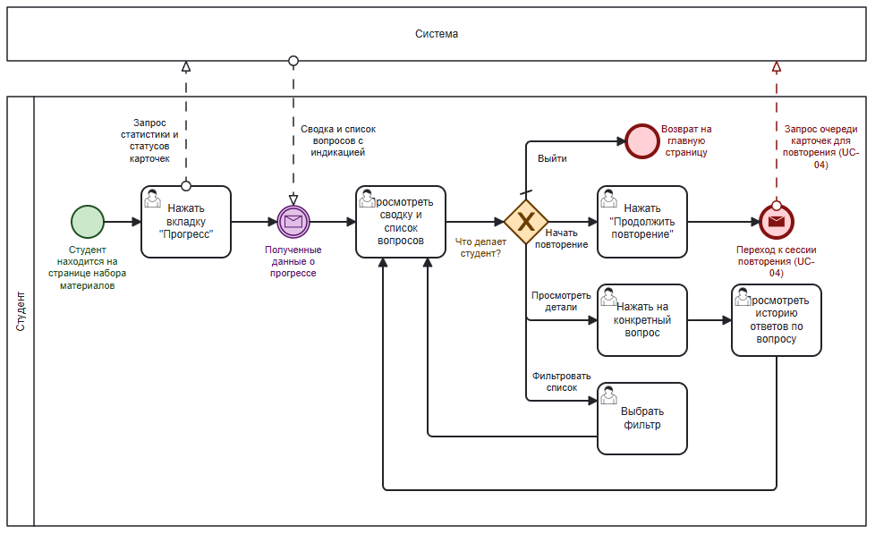

# UC-06. Просмотр прогресса усвоения

**Актёр:** Студент, готовящийся к зачёту

**Цель:** увидеть статистику своего обучения, понять, какие темы требуют внимания, и оценить, как близко он к полному закрытию набора

**Предусловия:** студент одобрил хотя бы одну карточку (UC-03) и имеет историю повторений

**Триггер:** студент открывает вкладку «Прогресс» в наборе материалов

## Графический сценарий

## Описание
Студент заходит в раздел статистики, чтобы оценить свои успехи. Он видит общую картину: сколько карточек уже выучено, сколько требует внимания, и сколько циклов повторения в среднем требуется для закрытия этого набора (главная метрика продукта).

## Начальное состояние
- В системе есть одобренные карточки и история хотя бы одной сессии повторения.
- Студент находится на главном экране или в меню набора материалов.

## Успешный сценарий (happy path)
1. Студент открывает страницу «Прогресс».
2. Студент видит сводку: общее количество карточек, количество пройденных циклов, процент усвоения и ожидаемое число циклов до полного закрытия набора.
3. Студент видит список всех вопросов со статусами:
   - **Усвоено** — ответил верно в последнем цикле;
   - **Требует внимания** — были ошибки или частичные ответы;
   - **Не начато** — карточка ещё не попадалась в сессии.
4. Студент нажимает на конкретный вопрос, чтобы увидеть историю своих ответов по нему (свои тексты и оценки).
5. Студент нажимает «Продолжить повторение» и переходит к тренировке, где в начале очереди стоят карточки со статусом «Требует внимания».

## Альтернативные сценарии
- **3а. Студент фильтрует список.** Студент выбирает фильтр «Требует внимания». Система скрывает остальные карточки, показывая только проблемные зоны.
- **5а. Студент завершил набор.** Все карточки имеют статус «Усвоено». Система показывает поздравление и предлагает начать новый, более сложный цикл или загрузить новый конспект.

## Негативные сценарии (error handling)
- **1а. Ошибка сети при загрузке статистики.** Система не может получить данные. Студент видит сообщение о проблеме и кнопку «Обновить».
- **1б. Нет данных для отображения.** Студент открыл прогресс, но ещё не одобрил ни одной карточки. Система предлагает перейти к экрану приёмки (UC-03).

## Конечное состояние
- При успешном сценарии — студент владеет актуальной информацией о своём прогрессе и может целенаправленно продолжить обучение.
- При негативных сценариях — статистика не отображена, студент может повторить попытку.

## Результат
Студент видит прозрачную картину своего усвоения материала, понимает свои слабые места и мотивирован продолжить повторение для закрытия набора.

## Как поймём, что работает
- Студент видит общую статистику и ожидаемое число циклов до закрытия.
- Индикация статусов (Усвоено / Требует внимания / Не начато) работает корректно.
- Фильтрация по статусу мгновенно обновляет список.
- История ответов по конкретному вопросу содержит даты, тексты студента и полученные оценки.
- Данные обновляются автоматически после каждой завершённой сессии повторения.
